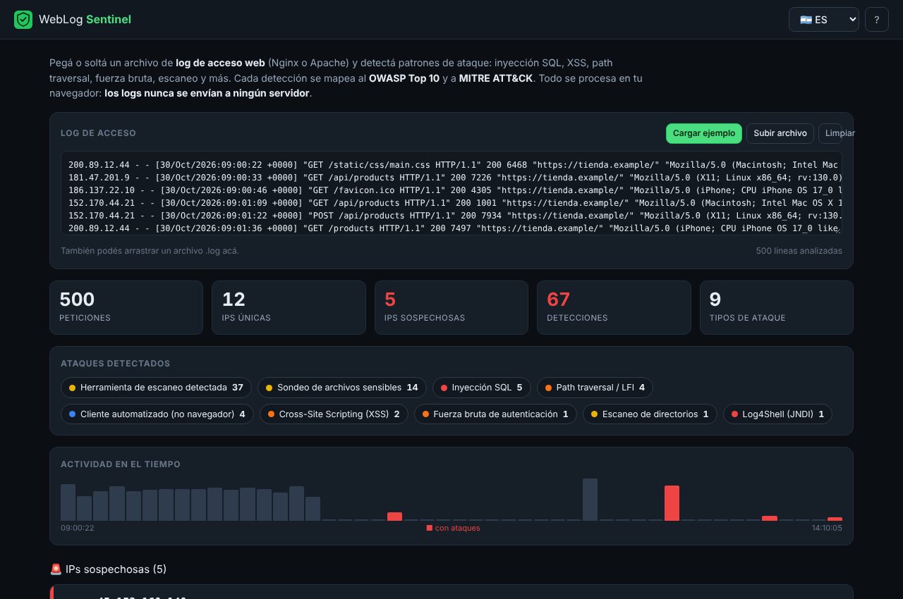
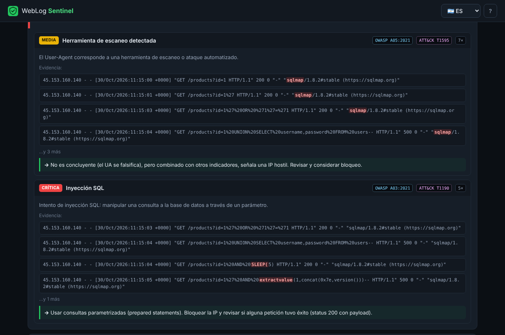

# WebLog Sentinel 🛡️

> 🇬🇧 [Read in English](README.md)

**Soltá un log de acceso web (Nginx / Apache) y obtené los ataques que contiene, ordenados y explicados.** Detecta inyección SQL, XSS, path traversal, inyección de comandos, Log4Shell, sondeo de archivos sensibles, herramientas de escaneo, fuerza bruta y escaneo de directorios, y mapea cada detección al **OWASP Top 10** y a **MITRE ATT&CK**. Todo corre en tu navegador: los logs nunca salen de tu equipo.

**🔗 Demo: https://ulisespignatelli.github.io/weblog-sentinel/** · 📄 [Log de ejemplo](docs/sample-access.log)



## Por qué

Cuando una aplicación web es atacada, la evidencia queda en los logs de acceso, pero leer miles de líneas a mano es imposible, y montar un SIEM completo es exagerado para un triage rápido o para un informe de pentest. WebLog Sentinel es el punto intermedio: **lee el log como lo haría un defensor**, destaca las IPs hostiles y muestra *exactamente qué línea* disparó cada detección.

Es el complemento **defensivo (blue team)** del trabajo ofensivo: lanzás un ataque y después ves cómo se ve desde el lado del defensor.

## Funcionalidades

- 🔎 **Detecta, con evidencia:** inyección SQL, XSS, path traversal / LFI, inyección de comandos, Log4Shell (JNDI), SSTI, sondeo de archivos sensibles, user-agents de escáneres (sqlmap, nikto, gobuster…), y por volumen, **fuerza bruta** y **escaneo de directorios**.
- 🧭 **Mapeado a estándares:** cada hallazgo lleva su categoría del **OWASP Top 10** y su técnica de **MITRE ATT&CK**.
- 🎯 **Ordenado por riesgo:** las IPs se ordenan por severidad máxima y luego por volumen, así lo crítico queda arriba. Cada IP se despliega y muestra las detecciones, las **líneas de log exactas como evidencia** (con el fragmento de ataque resaltado) y la recomendación.
- 📊 **De un vistazo:** cantidad de peticiones, IPs y detecciones, un desglose por tipo de ataque, y una línea de tiempo que resalta las ventanas donde hubo ataques.
- 🧪 **Parseo robusto:** formatos Common y Combined de Nginx/Apache, con decodificación de URL (incluido el doble encoding) para atrapar payloads tipo `%2e%2e%2f`.
- ⬇️ **Exportación:** informe en Markdown, JSON, o un hallazgo listo para [Pentest Findings Builder](https://github.com/ulisespignatelli/pentest-findings-builder).
- 🌐 **Bilingüe** (ES/EN), responsive y con un log de ejemplo integrado.



## Seguridad y privacidad desde el diseño

Los logs de acceso tienen IPs reales y datos de las peticiones, así que toda la herramienta está pensada para que no salgan del navegador:

| Control | Implementación |
|---|---|
| Los logs no salen del navegador | Sitio estático; la CSP define `connect-src 'none'`; el archivo se lee localmente con `FileReader` |
| Seguro ante entrada hostil | Todo valor de una línea de log se escapa antes de mostrarse: una línea con un payload de XSS se muestra inerte, con el payload resaltado, no se ejecuta (cubierto por tests) |
| CSP estricta | `script-src 'self'`, sin scripts en línea, `form-action 'none'`, `object-src 'none'` |
| Trabajo acotado | El tamaño de entrada y las muestras guardadas por IP están limitados |
| Cadena de suministro | Cero dependencias; CodeQL y Dependabot activados |

Más detalles en [SECURITY.md](SECURITY.md).

## Cómo funciona

- JavaScript puro, sin compilación ni framework, alojado gratis en GitHub Pages.
- `log.js` (parser) y `detect.js` (detección + correlación) son **puros y sin DOM**, así que el mismo código corre en el navegador y en Node para los tests.
- **15 tests unitarios** cubren el parseo (incluidas líneas malformadas y doble URL-encoding), cada detector, el caso "sin falsos positivos con tráfico normal" y la correlación por volumen (fuerza bruta, escaneo).

## Qué detecta

| Detección | OWASP | MITRE ATT&CK |
|---|---|---|
| Inyección SQL | A03:2021 | T1190 |
| Cross-Site Scripting (XSS) | A03:2021 | T1059.007 |
| Path traversal / LFI | A01:2021 | T1083 |
| Inyección de comandos | A03:2021 | T1190 |
| Log4Shell (JNDI) | A06:2021 | T1190 |
| Server-Side Template Injection | A03:2021 | T1190 |
| Sondeo de archivos sensibles | A05:2021 | T1083 |
| Herramientas de escaneo (sqlmap, nikto…) | A05:2021 | T1595 |
| Fuerza bruta de login | A07:2021 | T1110 |
| Escaneo de directorios | A05:2021 | T1595 |

## Uso local

```bash
cd site && python3 -m http.server 8000   # abrir http://localhost:8000
node --test                              # tests (Node 18 o superior, sin instalar nada)
```

## Límites (alcance honesto)

Es una **herramienta de triage y aprendizaje, no un SIEM**. La detección se basa en firmas y heurísticas, así que puede dar falsos positivos (un parámetro legítimo que parece un payload) y falsos negativos (ataques muy ofuscados). Validá siempre la evidencia. Para monitoreo en producción a escala, usá un SIEM real (Wazuh, Elastic, Splunk).

## Créditos y licencia

- Referencias: [OWASP Top 10](https://owasp.org/www-project-top-ten/), [MITRE ATT&CK](https://attack.mitre.org/).
- El código se distribuye bajo licencia [MIT](LICENSE).

> ⚖️ Para logs de sistemas propios o que tengas **autorización** para revisar.
