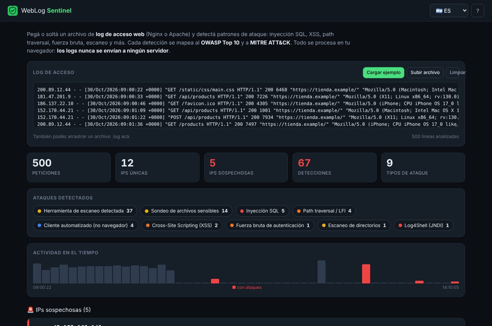
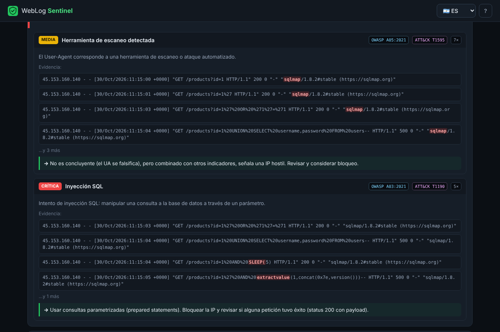
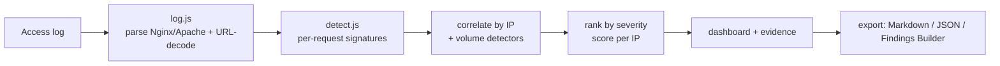

# WebLog Sentinel 🛡️

> 🇪🇸 [Leer en español](README.es.md)

**Drop a web access log (Nginx / Apache) and get the attacks in it, ranked and explained.** It detects SQL injection, XSS, path traversal, command injection, Log4Shell, sensitive-file probing, scanner tools, brute force and directory scanning — mapping every detection to the **OWASP Top 10** and **MITRE ATT&CK**. Everything runs in your browser, so the logs never leave your machine.

[](https://ulisespignatelli.github.io/weblog-sentinel/)
[](https://github.com/ulisespignatelli/weblog-sentinel/actions/workflows/tests.yml)
[](https://github.com/ulisespignatelli/weblog-sentinel/actions/workflows/codeql.yml)


[](LICENSE)

**🔗 Live: https://ulisespignatelli.github.io/weblog-sentinel/** · 📄 [Sample log](docs/sample-access.log)



## Why

When a web app gets attacked, the evidence is sitting in the access logs — but reading thousands of lines by hand is hopeless, and a full SIEM is overkill for a quick triage or a pentest write-up. WebLog Sentinel is the fast middle ground: **it reads the log the way a defender would**, surfaces the hostile IPs, and shows *exactly which line* triggered each detection.

It's a **blue-team** companion to offensive work: you run an attack, then watch what it looks like from the defender's side.

## Features

- 🔎 **Detects, with evidence:** SQL injection, XSS, path traversal / LFI, command injection, Log4Shell (JNDI), SSTI, sensitive-file probing, scanner user-agents (sqlmap, nikto, gobuster…), plus volume-based **brute force** and **directory scanning**.
- 🧭 **Mapped to standards:** every finding carries its **OWASP Top 10** category and **MITRE ATT&CK** technique.
- 🎯 **Ranked by risk:** IPs are sorted by worst severity then volume, so critical threats sit on top. Each IP expands to show the detections, the **exact log lines as evidence** (with the attack fragment highlighted), and remediation.
- 📊 **At a glance:** request/IP/detection counts, an attack-type breakdown, and a timeline that highlights the time windows where attacks happened.
- 🧪 **Robust parsing:** Nginx/Apache Common & Combined formats, with URL-decoding (including double-encoding) so `%2e%2e%2f` payloads are caught.
- ⬇️ **Export:** Markdown report, JSON, or a finding ready for [Pentest Findings Builder](https://github.com/ulisespignatelli/pentest-findings-builder).
- 🌐 **Bilingual** (ES/EN), responsive, with a built-in sample log.



## Security & privacy by design

Access logs contain real IPs and request data, so the whole tool is built so they never leave the browser:

| Control | Implementation |
|---|---|
| Logs never leave the browser | Static site; CSP sets `connect-src 'none'`; the file is read locally via `FileReader` |
| XSS-safe on hostile input | Every value from a log line is HTML-escaped before rendering — a log line containing an XSS payload is shown inert, with the payload highlighted, not executed (covered by tests) |
| Strict CSP | `script-src 'self'`, no inline scripts, `form-action 'none'`, `object-src 'none'` |
| Bounded work | Input size and per-IP stored samples are capped |
| Supply chain | Zero dependencies; CodeQL and Dependabot enabled |

See [SECURITY.md](SECURITY.md).

## How it works



- Vanilla JavaScript, no build step, no framework — hosted for free on GitHub Pages.
- `log.js` (parser) and `detect.js` (detection + correlation) are **pure and DOM-free**, so the exact same code runs in the browser and in Node for the tests.
- **15 unit tests** cover parsing (including malformed lines and double URL-encoding), every detector, the "no false positives on normal traffic" case, and the volume-based correlation (brute force, scanning).

## Detections

| Detection | OWASP | MITRE ATT&CK |
|---|---|---|
| SQL injection | A03:2021 | T1190 |
| Cross-Site Scripting (XSS) | A03:2021 | T1059.007 |
| Path traversal / LFI | A01:2021 | T1083 |
| Command injection | A03:2021 | T1190 |
| Log4Shell (JNDI) | A06:2021 | T1190 |
| Server-Side Template Injection | A03:2021 | T1190 |
| Sensitive-file probing | A05:2021 | T1083 |
| Scanner tools (sqlmap, nikto…) | A05:2021 | T1595 |
| Login brute force | A07:2021 | T1110 |
| Directory scanning | A05:2021 | T1595 |

## Run locally

```bash
git clone https://github.com/ulisespignatelli/weblog-sentinel.git
cd weblog-sentinel/site
python3 -m http.server 8000      # open http://localhost:8000
```

Tests (Node ≥ 18, no install needed):

```bash
node --test
```

## Limitations (honest scope)

This is a **triage and learning tool, not a SIEM**. Detection is signature/heuristic based, so it can produce false positives (a legitimate parameter that looks like a payload) and false negatives (heavily obfuscated attacks). Always validate the evidence. For production monitoring at scale, use a real SIEM (Wazuh, Elastic, Splunk).

## Roadmap

- [ ] More formats (JSON logs, IIS, auth.log / SSH)
- [ ] GeoIP / ASN enrichment for suspicious IPs
- [ ] Generate ready-to-use firewall / WAF block rules

## Credits & license

- References: [OWASP Top 10](https://owasp.org/www-project-top-ten/), [MITRE ATT&CK](https://attack.mitre.org/).
- Code licensed under [MIT](LICENSE).

> ⚖️ For logs from systems you own or are **authorized** to review.
